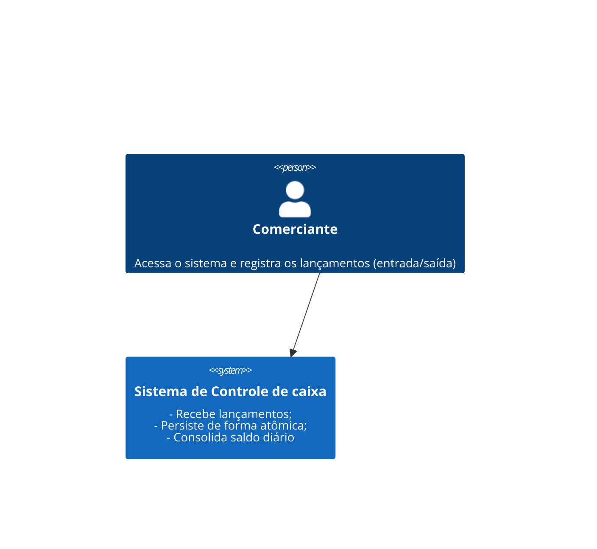
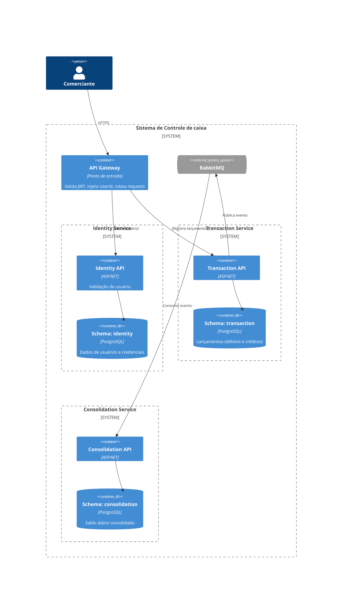
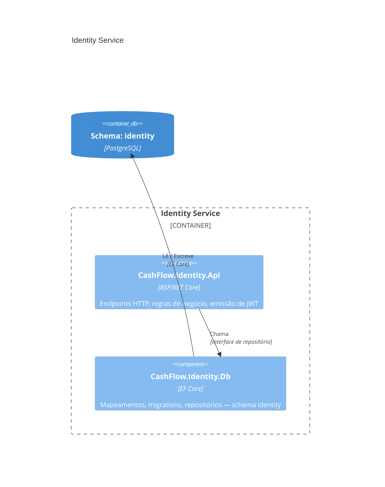
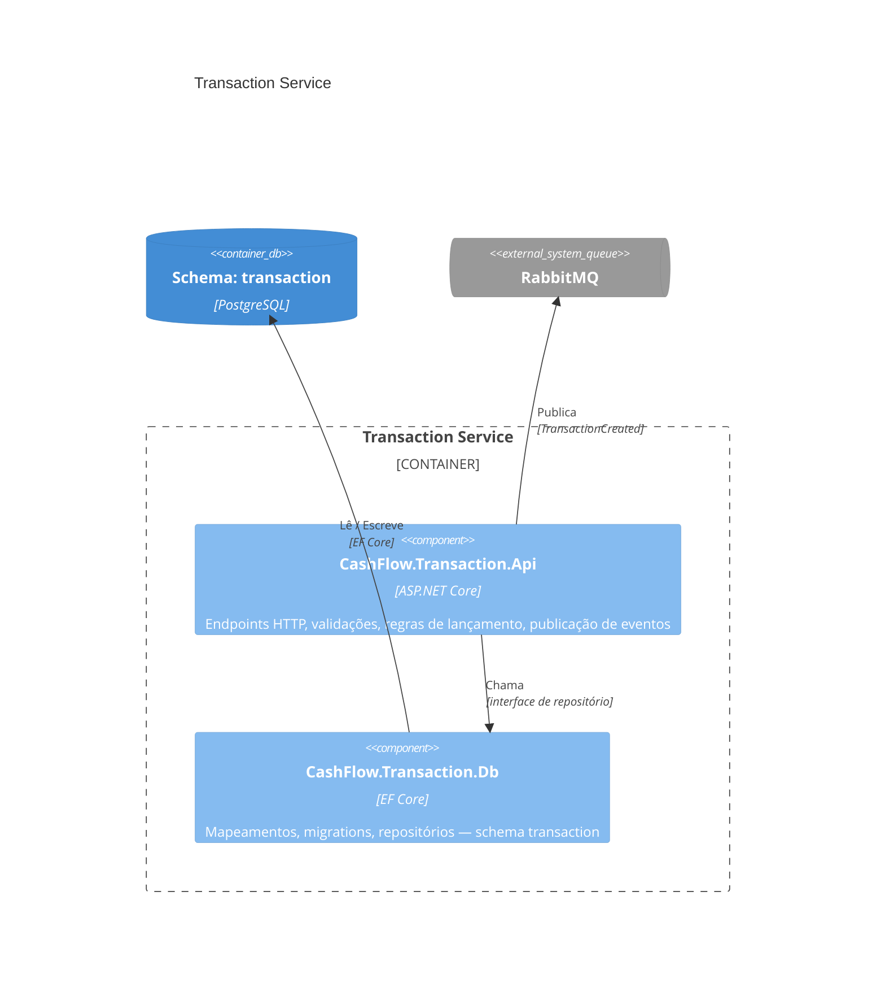
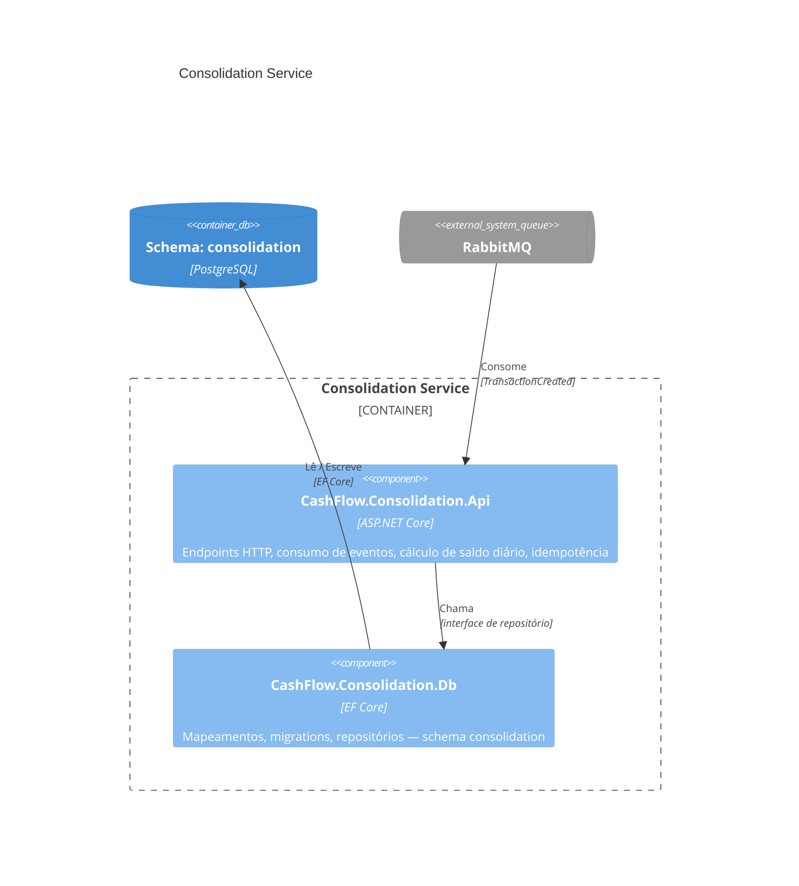

# Documento de arquitetura

## C4

### Contexto (1o Nível)

## Microsserviços e Regras de Negócio

Cada microsserviço é composto por dois projetos:

| Sufixo | Responsabilidade |
|--------|-----------------|
| `.Api` | Regras de negócio, validações, casos de uso, endpoints HTTP |
| `.Db`  | Acesso a dados: mapeamentos, migrations, repositórios (EF Core) |

### Identity Service (`CashFlow.Identity.*`)

Responsável por autenticação e emissão de tokens.

**Regras de negócio (`.Api`):**
- Registrar um novo usuário (e-mail único, senha com hash)
- Autenticar usuário com e-mail e senha — retorna JWT
- O JWT carrega o `UserId` como claim; tempo de expiração configurável

**Dados (`.Db` / schema `identity`):**
- Tabela `users`: id, e-mail, hash de senha, data de criação

---

### Transaction Service (`CashFlow.Transaction.*`)

Responsável por receber e persistir lançamentos do comerciante.

**Regras de negócio (`.Api`):**
- Registrar lançamento para o usuário autenticado
  - Tipo deve ser `Débito` ou `Crédito`
  - Valor deve ser positivo e não-zero
  - Data do lançamento não pode ser futura
- Listar lançamentos do usuário autenticado (com filtro opcional por data)
- Após persistir, publicar evento `TransactionCreated` no RabbitMQ de forma atômica (Outbox ou dentro da mesma transação)

**Dados (`.Db` / schema `transaction`):**
- Tabela `transactions`: id, user_id, tipo, valor, descrição, data, data de criação

---

### Consolidation Service (`CashFlow.Consolidation.*`)

Responsável pelo saldo diário consolidado.

**Regras de negócio (`.Api`):**
- Consumir evento `TransactionCreated` do RabbitMQ
  - Atualizar (ou criar) o saldo do dia correspondente ao `UserId` do evento
  - Idempotência: reprocessar o mesmo evento não deve alterar o saldo
- Consultar saldo diário consolidado por data para o usuário autenticado
  - Retornar saldo zerado para dias sem lançamentos (sem erro)

**Dados (`.Db` / schema `consolidation`):**
- Tabela `daily_balances`: id, user_id, data, saldo, data de atualização
- Tabela `processed_events`: event_id — garante idempotência no consumo

---

### Container (2o Nível)

### Componente (3o Nível) — separação `.Api` / `.Db`

Cada microsserviço é dividido internamente em dois projetos. O projeto `.Api` concentra as regras de negócio e chama o `.Db` para persistência — nunca o contrário.

